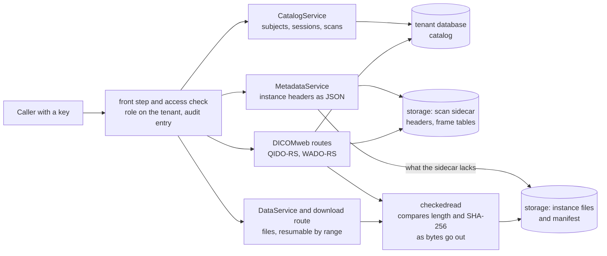

# Reading the archive

[Documentation index](README.md) · [Architecture](architecture.md) · [A reception, end to end](reception.md) · [Receiving through the API](api-walkthrough-reception.md)

Everything archived is read back through the API, with a key that holds a grant
on the tenant, and every read is audited. The contract is in
`api/proto/coria/v1`; the handlers are [internal/api](../internal/api/doc.go).

| What you want | Where it is served |
|---|---|
| Subjects, sessions and scans, with filters and pages | `CatalogService` (`coria catalog`) |
| Each instance's DICOM header as JSON | `MetadataService` (`coria scan show --metadata`) |
| The files of a scan, checked as they stream | `DataService` over gRPC and Connect; one instance over HTTP, resumable by range (`coria download`) |
| Search, retrieve, metadata, frames and bulk data in the DICOMweb way | QIDO-RS and WADO-RS under `/tenants/<name>/dicom-web` (PS3.18 10.4, 10.6) |
| Store through HTTP | STOW-RS at the same path, into a receiver that lists the key (PS3.18 10.5); see [a reception](reception.md) |

## How a read goes

After the [path every request takes](architecture.md#the-path-of-a-request), a
read is answered from the catalog in the tenant's database, from what each scan's
[sidecar](../internal/receive/sidecar/doc.go) holds on the storage (headers and
[frame tables](../internal/receive/frames/doc.go)), and from the instance files
themselves, which [checkedread](../internal/checkedread/doc.go) compares with the
manifest as they go out.

[dicomweb](../internal/dicomweb/doc.go) holds the protocol without the archive: what
a path names, how a search is read, matching, paging, media types and Warning
headers. [place](../internal/place/doc.go) opens the storage a scan lives on.

## What a read checks, and its bounds

- **A whole instance** (a retrieve, a download) is checked against the SHA-256 it
  was archived with as it is sent; a mismatch cuts the answer before its last
  piece.
- **A frame** is checked against the SHA-256 the scan's sidecar records for it
  beside its ranges, as it is sent; a mismatch cuts the multipart body before the
  frame's last piece. A frame of a line that holds no table yet (a sidecar written
  before frame tables, until the pass at start gives it its tables) is found from
  the file's header and sent unchecked.
- **A bulk data window** (a BulkDataURI, a download with offset and length) is not
  checked: no checksum of a part of a file is recorded, so bytes changed inside a
  window are not found by reading it. A retrieve of the whole instance finds them.
- **Metadata** is answered from the sidecar and, for what it does not hold, from a
  read of the file's header, which is checked against the size the catalog holds,
  not against its checksum: a stored file changed without a change of size is not
  found by the metadata service.
- **A search** holds one of the caller's open reads, as a retrieve does, and one
  scan's sidecar open at a time. It is refused with 413 when it passes over more
  than 10,000 rows it does not keep, or reads more than 256 MiB of sidecars to find
  its results; making them may read as much again, past which the answer is cut.
  Its answer is streamed one result at a time; an answer of instances stops at
  64 MiB of results, with the Warning that more results can be requested.
  A search the catalog can narrow by index (a study, a series, a subject's
  PatientID, a StudyDate range, a Modality) is the one that stays inside these
  bounds.
