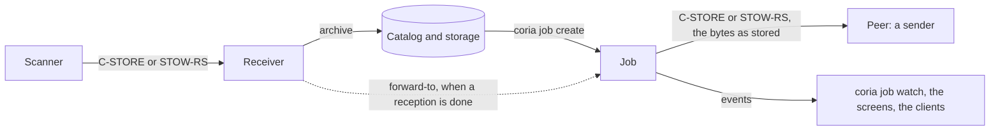
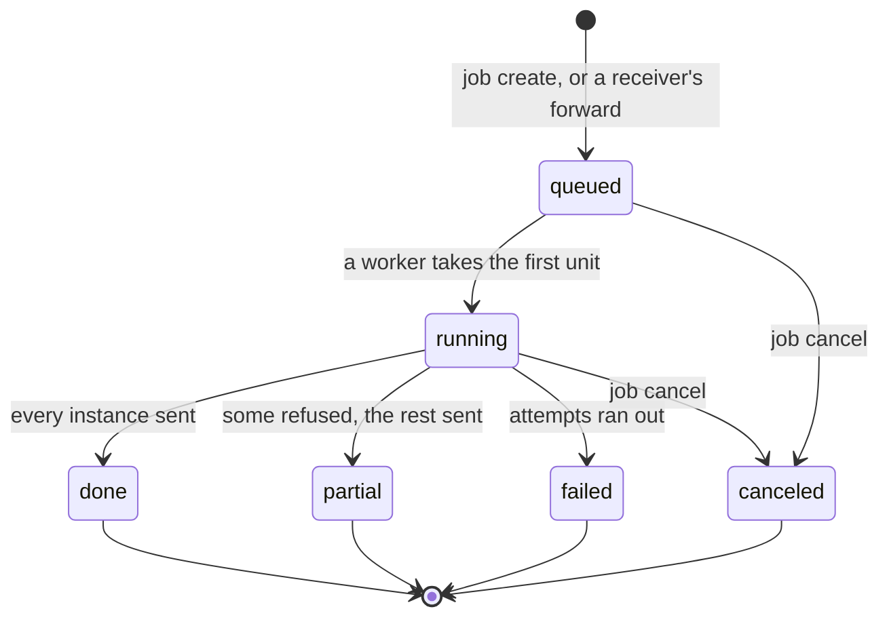

# Sending data on

[Documentation index](README.md) · [The command line](command-line.md) · [Settings](settings.md) · [A reception, end to end](reception.md)

A *sender* is a place archived data may be sent to: a PACS, an Orthanc, another
CORIA. A *job* is the work of sending one subject, session or scan to a sender.
Nothing is sent by itself: a person makes a job, or a receiver that lists the
sender in its `forward-to` makes one for each reception it completes. The rules
are in [send](../internal/send/doc.go) (how the work is carried out and made safe
to repeat) and in the contract's comments on
[`sender.proto`](../api/proto/coria/v1/sender.proto) and
[`job.proto`](../api/proto/coria/v1/job.proto).

## What you can do



Two kinds of sender:

- **dimse**: the server opens an association with the peer and sends each
  instance by C-STORE. The peer must admit the server's calling AE title.
- **stow**: the server stores instances into the peer's DICOMweb service
  (STOW-RS), with no authentication or with basic, bearer or a named header. The
  credential is read from a file, standard input or a variable, never from an
  argument; the server seals it and never answers it.

Both send the archived bytes as they are stored. Nothing is decoded or
re-encoded, so a peer that does not take an instance's transfer syntax refuses it
and the job lists it as a failure; it is never sent in another syntax.

## Where a sender may send

Sending moves patient data out of the archive, so where a sender may go is the
installation's to decide, not the tenant's. The setting `sender.destinations`
lists the hosts and address ranges (with their ports) a sender may reach; it is
empty by default, so no sender can be added until the installation's admin fills
it. `sender.allow-plain-http` allows a stow sender's URL to be `http`. Every time
a sender connects the server resolves its host again and connects only to an
address the setting allows. See [Settings](settings.md).

## The steps

1. An installation admin allows the destination:
   `coria setting set sender.destinations "pacs.lab.example ports=104"`.
2. A tenant admin adds the sender and tries it. Adding connects to nothing;
   `sender test` does, and says in plain words what it found.

   ```sh
   coria sender add lab1 pacs --type dimse --host pacs.lab.example --port 104 \
       --called-aet ORTHANC --calling-aet CORIA --enabled
   coria sender test lab1 pacs
   ```

   For a stow sender, `--credential-file` or `--credential-stdin` gives the
   credential: `printf '%s' "$TOKEN" | coria sender add lab1 archive2 --type stow
   --url https://pacs2.lab.example/dicom-web --authentication bearer
   --credential-stdin`.
3. An operator makes a job and follows it to its end.

   ```sh
   coria job create lab1 --sender pacs sub-0017/ses-2026-03-02
   coria job watch lab1 <job id>
   ```

   `job watch` shows the job, then a line for each change of state and each
   report of progress, and exits 0 only when the job ended done. It reads the
   tenant's event feed from the position the job was read at, so no change is
   missed, and follows again if the server ends a stream.
4. To send everything a receiver archives, name the sender on the receiver:
   `coria receiver set lab1 scanner1 --forward-to pacs`. Each reception that
   reaches done makes a job for exactly the instances it archived. A sender that
   is down holds its jobs; it never holds or fails the reception.

## What a job does and how it ends



A job sends the instances the catalog held when it was made. Its work is one unit
per scan. A unit that fails for a temporary cause is tried again after a wait that
doubles from 10 seconds to an hour; while the sender is down or stopped no attempt
is used, so a peer down overnight fails nothing. What is sent is at least once: if
the server stops midway, at most one batch per unit is sent again.

`job failures <tenant> <id>` lists the instances the peer refused, with its
status and a reason (`--warnings` adds those it kept with a warning).
`job retry` makes a new job for what an ended job did not send; `job cancel`
ends one that is queued or running.

## Where to see it

| Where | What it shows |
|---|---|
| `coria sender list`, `show` | Each sender with its health: up, not connected to yet, or down with the reason |
| `coria job list`, `get` | Jobs with their state and how many instances are sent, refused and remaining |
| `coria job watch` | One job, live, until it ends |
| The interactive program | On a tenant, `n` lists the senders with their health and tests a peer; `w` lists the jobs with a progress bar that follows the event feed, a job's screen opens its failures, and cancel and retry ask for the job's id typed. See [The command line](command-line.md) |
| The API | `SenderService`, `JobService`, and `MonitorService.Watch` for the events; the Python and TypeScript clients each have an example that makes a job and follows it, in `clients/python/examples/follow_job.py` and `clients/typescript/examples/follow-job.ts` |

## What is weak

- A sender's credential is sealed with the installation key. Losing the key file
  loses it, as it loses every other secret.
- Without TLS a dimse sender's associations are plain TCP and every instance
  crosses the network unencrypted; that is fit only for a network the site
  trusts. DIMSE user identity is not offered.
- A peer that keeps both copies of an instance sent twice keeps both: the same
  SOP Instance UID with the same bytes is a repeat to every peer tried, but not
  to every peer there is.
